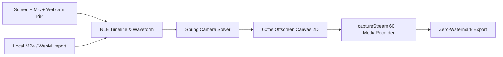

<div align="center">

<br />

# ZOOMCAST STUDIO

**Cinema-grade auto-zoom screen recording — engineered for the browser.**
<br />
<sub>Zero watermarks. Zero cloud uploads. Zero $229 macOS lock-in.</sub>

<br />

<p>
  <a href="https://zoomcast-studio.vercel.app/"><code>&nbsp;🚀 Launch Live Studio&nbsp;</code></a>
  &nbsp;&nbsp;
  <a href="https://github.com/a1n2a3s6/zoomcast-studio/stargazers"><code>&nbsp;★ Star on GitHub&nbsp;</code></a>
  &nbsp;&nbsp;
  <a href="#technical-specifications"><code>&nbsp;⚙ Technical Specs&nbsp;</code></a>
  &nbsp;&nbsp;
  <a href="#self-hosting--local-build"><code>&nbsp;⬇ Run Locally&nbsp;</code></a>
</p>

<br />

<a href="https://zoomcast-studio.vercel.app/">
  
</a>

</div>

<br />

---

## Philosophy

Most product demos fail for one simple reason: flat, static full-screen recordings force viewers to squint at tiny UI details. Tools like **Screen Studio** solved this with spring-physics auto-zoom — but locked it behind **$229** and **macOS-only** binaries.

**ZoomCast Studio** brings that exact editorial polish to **Windows, Linux, and macOS** inside a single local-first web studio. Every frame, spring camera curve, audio waveform, and 60fps export renders directly on your machine's GPU with **zero server uploads** and **zero watermarks**.

---

## 01 · Spring Camera Optics

Instead of robotic linear scaling, ZoomCast computes real-time **spring-damped interpolation** across overlapping zoom keyframes, clamping camera translation strictly inside frame boundaries so edges never tear or expose empty gutters.

<table>
  <tr>
    <td width="55%" valign="top">
      <strong>Click-to-Target Precision</strong><br />
      Click anywhere on the live preview viewport to drop a zoom keyframe at the current playhead timestamp. Tune depth (<code>1.4× – 3.0×</code>), duration, and optional spotlight vignette directly in the Optics Inspector.
    </td>
    <td width="45%" valign="top">
      <pre><code>// Smooth camera state at timestamp t
scale(t) = 1 + (targetScale - 1) · easeSpring(p)
panX(t)  = clamp(focusX · (1 - 1/scale), 0, maxPan)
ripple   = radialGlow(focusX, focusY, p)</code></pre>
    </td>
  </tr>
</table>

---

## 02 · Multi-Format Framing & Audio Waveform NLE

Record once — ship everywhere. Switch seamlessly between **16:9** (YouTube & GitHub READMEs), **9:16** (Instagram Reels, TikTok & Shorts), **1:1** (Square), and **4:3** without re-recording a single second.

<table>
  <tr>
    <td width="45%" valign="top">
      <pre><code>Transport Shortcuts (Industry NLE)
──────────────────────────────────
Space   Play / Pause
Z       Drop Zoom Keyframe at Playhead
I / O   Set Trim In / Trim Out
J / K / L  Step Back / Stop / 2× Forward
Del     Remove Selected Keyframe</code></pre>
    </td>
    <td width="55%" valign="top">
      <strong>Real Decoded Audio Waveforms</strong><br />
      ZoomCast decodes your microphone/system audio via the Web Audio API (<code>decodeAudioData</code>) directly onto the timeline track — letting you align zooms and trims to exact vocal pauses or beats, alongside a floating circular <b>Webcam PiP</b> bubble.
    </td>
  </tr>
</table>

---

## 03 · Zero-Upload Local 60fps Render Pipeline



---

## Technical Specifications

| Specification | Detail |
| :--- | :--- |
| **Capture Sources** | Window, Browser Tab, Full Monitor (`getDisplayMedia`), Microphone Audio, Webcam PiP |
| **Input Import** | Import existing `.mp4` / `.webm` recordings + Built-in 8s Synthetic Demo Clip |
| **Output Presets** | `1920×1080` (16:9), `1080×1920` (9:16 Reels), `1080×1080` (1:1), up to `60fps` |
| **Privacy Model** | 100% Client-Side Execution — `0 KB` uploaded, `0` accounts, `0` watermarks |
| **Core Stack** | React 18 · TypeScript 5 · Vite 5 · Tailwind CSS · HTML5 Canvas 2D · Web Audio API |
| **Platform Support** | Windows, Linux & macOS (Chrome, Edge, Brave, Arc) |

<details>
<summary><strong>Inspect Source Architecture</strong></summary>

```text
zoomcast-studio/
├── assets/
│   └── cinema-stage.svg         # Animated 60fps hardware studio viewport
├── src/
│   ├── types/studio.ts          # ZoomKeyframe, StudioConfig & Clip models
│   ├── engine/
│   │   ├── easing.ts            # Spring-damped zoom & clamped pan math
│   │   ├── compositor.ts        # 60fps Canvas renderer (backdrop, shadow, ripple, PiP)
│   │   ├── recorder.ts          # Screen + Mic + Webcam capture controller
│   │   └── exporter.ts          # Offscreen 60fps Canvas-to-Video exporter
│   └── components/
│       ├── TopBar.tsx           # Aspect ratios, transport & export CTA
│       ├── CaptureBar.tsx       # Record / Import / Built-in Demo launcher
│       ├── CanvasPreview.tsx    # Interactive click-to-zoom viewport
│       ├── TimelineEditor.tsx   # Waveform track, Trim handles & Zoom pills
│       └── StyleInspector.tsx   # Optics, backdrops, padding, radius & speed
└── package.json
```

</details>

---

## Self-Hosting & Local Build

```bash
git clone [https://github.com/a1n2a3s6/zoomcast-studio.git](https://github.com/a1n2a3s6/zoomcast-studio.git)
cd zoomcast-studio
npm install
npm run dev
```

Or deploy your own private studio to Vercel in one click: **[Deploy to Vercel →](https://vercel.com/new/clone?repository-url=https://github.com/a1n2a3s6/zoomcast-studio)**

---

<div align="center">
  <br />
  <sub>
    <strong>ZoomCast Studio</strong> — Built by <a href="https://anas-alhelaly.vercel.app/"><strong>Anas Alhelaly</strong></a> · Day 17 of <em>365 Projects in 365 Days</em> · MIT License
    <br />
    <a href="https://anas-alhelaly.vercel.app/">Portfolio</a> &nbsp;·&nbsp;
    <a href="https://github.com/a1n2a3s6">GitHub</a> &nbsp;·&nbsp;
    <a href="https://www.instagram.com/anas.alhelaly/">Instagram</a>
  </sub>
  <br />
</div>
